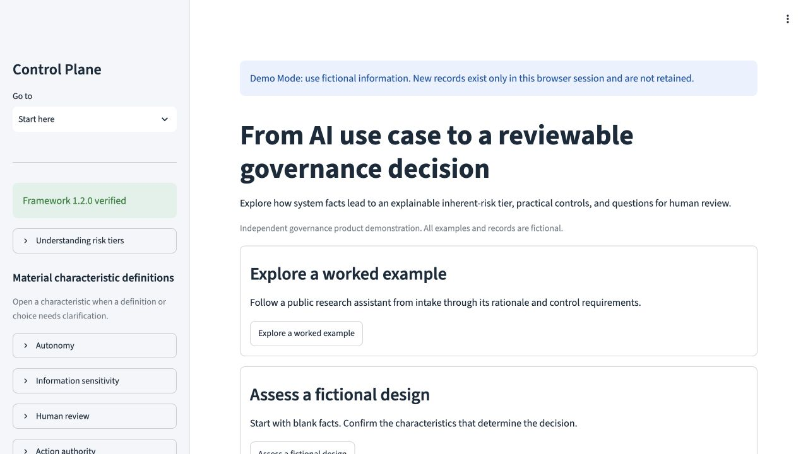
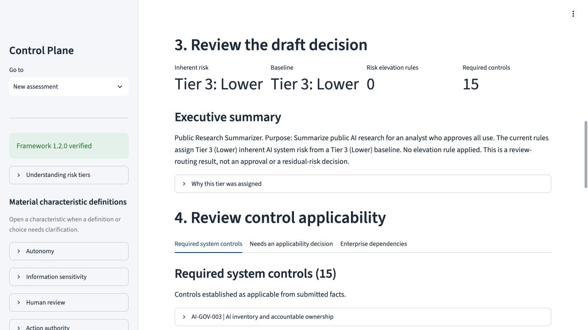
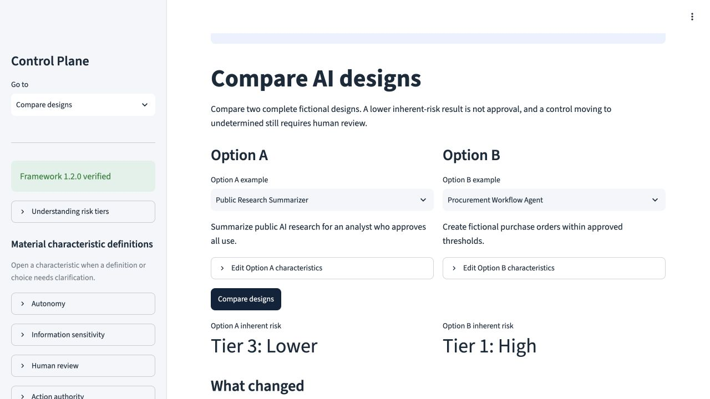

# Walk through a fictional governance decision

Use **Start here → Explore a worked example** for a guided demonstration, **Assess a fictional design** for blank intake, or **Compare two designs** to explore a tradeoff. All information is synthetic.

## Candidate screenshots

These screenshots were captured from the locally verified candidate on October 19, 2026. They do not establish that the public deployment has been updated.

## Worked example

1. Load Public Research Summarizer. It drafts research summaries for human review using public information.
2. Confirm the prefilled facts. Run assessment. The published model assigns Tier 3: Lower inherent risk for this design. This still requires governance review.
3. Read the executive summary, baseline rationale, required controls, unresolved applicability questions, and enterprise inheritance questions. Expand the assessed facts and provenance when needed.
4. Download the review brief or JSON. The brief is a decision-support record, not approval or evidence that controls work.
5. Choose an inventory destination explicitly. Review proposed changes, then submit only if you want the session inventory updated.

## Compare a design change

Open Compare designs, select two examples, and optionally edit characteristics. Compare results to see changed facts, matched risk rules, and control outcome transitions. Tier 1 is highest. A control becoming undetermined still requires facts and qualified judgment. Implementing controls does not lower inherent risk in this model.

## Reassess an existing system

Select a system in inventory and choose Reassess selected system. Change the facts, run the assessment, and inspect the before/after preview. Submission updates current facts and appends history. Earlier assessed facts remain in their original history records. Changing inputs makes an existing draft stale until it is recalculated.

## If the hosted application is unavailable

The walkthrough and source remain usable. Run the candidate locally with `python -m pip install -r requirements.txt` and `streamlit run app.py`. Community Cloud may hibernate after inactivity. A Framework integrity error requires operator repair, never bypassing verification.

The Framework owns control requirements. The Control Plane owns deterministic evaluation. A qualified human owns the final decision. No real organizational implementation or production approval is implied.
